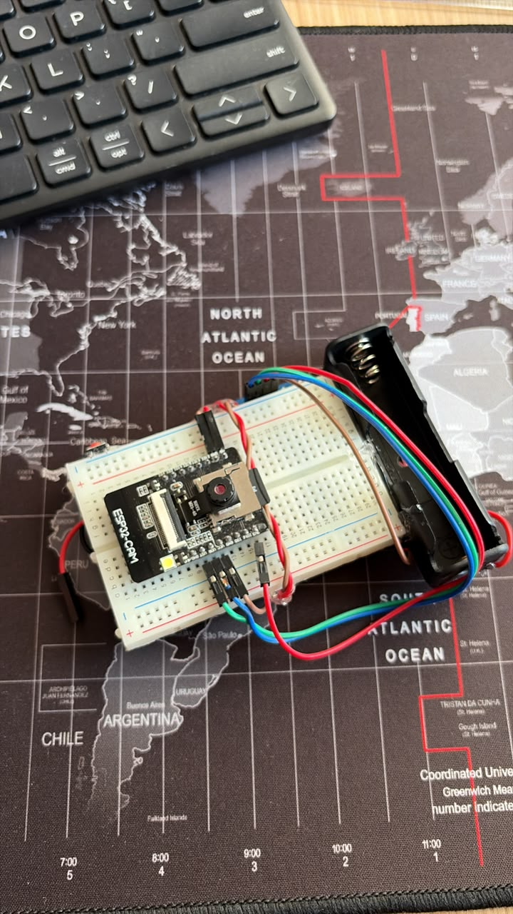
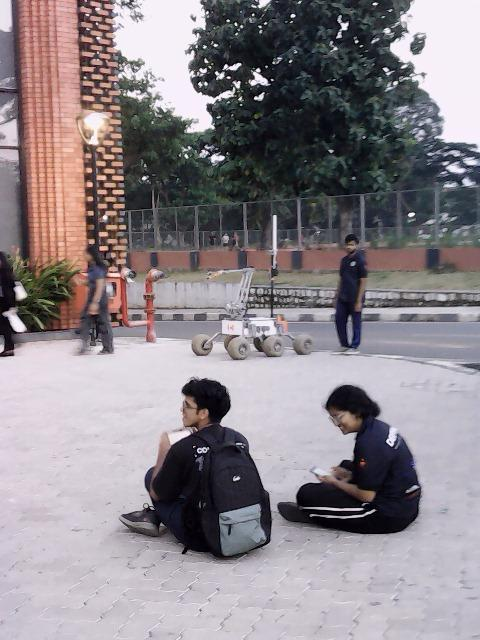
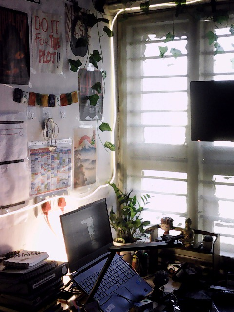

# DigiCam — A DIY Digital Camera Built on ESP32

**A tiny, open-source digital camera built from affordable electronics, custom firmware, and a monochrome OLED interface.**

DigiCam is an experiment in building a dedicated digital camera from scratch using an ESP32-CAM and a GC2145 image sensor. It combines physical-button controls, an OLED menu system, SD-card photo storage, creative image processing, and wireless tools in a compact DIY build.

The idea is simple: build a camera that feels like a camera, not a development board with a web page.

> **Project status:** Working prototype. Hardware behavior and firmware features may vary by build. See the documentation and acceptance tests before reproducing the project.

<p align="center">
  
</p>

<p align="center">
  <em>Replace this image with a real photograph of your completed camera.</em>
</p>

## Contents

- [Features](#features)
- [Hardware](#hardware)
- [Bill of materials](#bill-of-materials)
- [How it works](#how-it-works)
- [Wiring](#wiring)
- [Getting started](#getting-started)
- [Taking your first photo](#taking-your-first-photo)
- [Wireless features](#wireless-features)
- [Camera orientation](#camera-orientation)
- [Project structure](#project-structure)
- [Sample photos](#sample-photos)
- [Troubleshooting](#troubleshooting)
- [Roadmap](#roadmap)
- [Contributing](#contributing)
- [License](#license)

## Features

- **Compact camera hardware:** AI-Thinker ESP32-CAM with a GC2145 image sensor.
- **OLED interface:** SH1106 monochrome display with a lightweight menu system.
- **Physical controls:** Single-button navigation and camera interaction.
- **SD-card storage:** Save photographs locally.
- **640 × 480 capture target:** VGA capture, with QVGA fallback where needed.
- **Orientation options:** 0°, 90°, 180°, and 270° image rotation.
- **Self-timer:** Configurable countdown options, subject to the firmware build.
- **Creative processing:** Image styles and other processing options supported by the current firmware.
- **Wireless utilities:** Separate workflows for photo transfer, time setting, and firmware updates.
- **OTA firmware updates:** Browser-based updating when the relevant OTA configuration is installed and working.
- **Persistent settings:** SD-card-based configuration, with safe defaults when the configuration is unavailable.
- **Privacy-minded defaults:** Wi-Fi and the flash LED are off by default.

See the current firmware source and `docs/ACCEPTANCE_TESTS.md` for the exact behavior verified on your build. Features that depend on the sensor driver, available memory, or SD card may have limitations.

## Hardware

The current prototype uses the following components.

| Component | Purpose |
|---|---|
| AI-Thinker ESP32-CAM | Main controller and camera interface |
| GC2145 | Image sensor |
| SH1106 128 × 64 OLED | Camera UI and status display |
| Momentary push button | User input |
| microSD card | Photo and configuration storage |
| Boost converter | Power supply regulation |
| TP4056 charging module | Li-ion battery charging |
| Li-ion battery and holder | Portable power source |
| USB-to-UART adapter | Initial firmware flashing and recovery |

### Bill of materials

Approximate component costs in Indian rupees, based on the parts used for this prototype.

| Component | Cost (INR) | Notes |
|---|---:|---|
| ESP32-CAM | ₹620 | AI-Thinker board |
| 1.3-inch SH1106 OLED | ₹400 | 128 × 64 monochrome display |
| Boost converter | ~₹90 | Approximate purchase cost |
| TP4056 charging module | TBD | Price not recorded |
| Push button | TBD | Depends on the part used |
| Battery and holder | TBD | Depends on capacity and type |
| microSD card | TBD | Capacity and brand vary |
| Wires, connectors and other materials | TBD | Depends on assembly |

**Known subtotal: approximately ₹1,110**, excluding the charging module, battery, SD card, button, wiring, and other materials.

Your final build cost will depend on which components you already have and where you buy them. Prices are indicative, not current market quotes.

## How it works

At a high level, the camera follows this flow:

1. The ESP32 initializes the camera and display.
2. The OLED presents the camera interface and current state.
3. Button input drives navigation and camera actions.
4. The camera captures a frame.
5. Image processing applies the selected orientation and supported effects.
6. The resulting JPEG is stored on the microSD card.
7. Wireless services start only when explicitly requested.

The camera uses the sensor's supported output formats and software JPEG conversion where required. This is particularly important for sensor configurations that do not provide a compatible hardware-JPEG output path.

## Wiring

**Keep the working pin assignments unchanged when reproducing this build.**

| Component | ESP32-CAM connection |
|---|---|
| OLED SDA | GPIO 3 (U0R / RX) |
| OLED SCL | GPIO 1 (U0T / TX) |
| OLED power | 3.3 V |
| OLED ground | GND |
| Button | GPIO 13 to GND |
| Button configuration | `INPUT_PULLUP` |
| Onboard flash LED | GPIO 4 |
| microSD | SD_MMC, 1-bit mode |

The OLED uses the ESP32-CAM's UART pins. This saves other GPIOs but means the display must be disconnected from GPIO 1 and GPIO 3 during serial flashing.

The button connects GPIO 13 to ground when pressed. Use the two electrically distinct sides of the momentary switch, not two terminals that are permanently connected.

### Important power and flashing notes

- Use a stable, regulated 5 V supply capable of handling ESP32-CAM current peaks.
- Do not rely on the USB-to-UART adapter's 3.3 V output to power the complete camera.
- To flash through UART, connect the adapter's TX to GPIO 3, RX to GPIO 1, and GND to GND.
- Pull GPIO 0 to GND for serial flashing, then remove that connection for normal boot.
- Disconnect the OLED's SDA/SCL wires from GPIO 3/GPIO 1 while flashing, then reconnect them afterward.
- Keep SD_MMC in 1-bit mode for this pin configuration.

Double-check your particular board's labels before applying power. Incorrect wiring can damage the board or connected peripherals.

## Getting started

### Requirements

- An AI-Thinker ESP32-CAM board and compatible GC2145 camera
- A compatible SH1106 OLED
- A microSD card
- A USB-to-UART adapter for the first flash and recovery
- A stable 5 V supply
- [Visual Studio Code](https://code.visualstudio.com/)
- The [PlatformIO IDE extension](https://platformio.org/install/ide?install=vscode)

### 1. Clone the repository

```bash
git clone https://github.com/YOUR_USERNAME/DigiCam.git
cd DigiCam
```

Replace `YOUR_USERNAME` and `DigiCam` with the actual GitHub username and repository name.

### 2. Open the project

Open the repository folder in VS Code and let PlatformIO initialize the project.

Check `platformio.ini` for the intended environment and partition configuration. Use the project configuration as supplied rather than substituting a generic ESP32-CAM example.

### 3. Prepare the microSD card

Use a compatible, correctly formatted microSD card. Insert it before booting the camera if the firmware expects the card during initialization.

The firmware uses the SD card for photos and configuration. If the card is missing or the configuration cannot be read, follow the documented safe-default behavior.

### 4. Flash over USB

1. Disconnect the OLED's SDA and SCL connections from the UART pins.
2. Connect the USB-to-UART adapter.
3. Connect GPIO 0 to GND.
4. Select the correct PlatformIO environment.
5. Build and upload the firmware.
6. Remove GPIO 0 from GND.
7. Disconnect the UART adapter's TX/RX connections.
8. Reconnect the OLED and restart the camera.

Keep the USB recovery method available until you have tested wireless updates successfully.

### 5. Verify startup

Check that the OLED initializes, the camera is detected, the SD card is accessible, and the menu responds to the button. If the camera fails to initialize, consult the troubleshooting guide and serial output before changing wiring or firmware settings.

## Taking your first photo

1. Power on the camera.
2. Wait for startup and camera initialization to finish.
3. Use the physical button to navigate the menu.
4. Select the camera or capture action.
5. Wait for the save operation to complete.
6. Check the SD card for the resulting image.

For your first test, use good lighting and the default image settings. Confirm that the saved image opens correctly before experimenting with creative effects or rotation.

## Wireless features

Wireless functionality is intentionally opt-in. The camera should not start an access point during ordinary capture unless a wireless feature has been requested.

The firmware provides separate workflows for:

- **Set Date & Time:** Open the time-setting workflow and submit the local date, time, and timezone from a browser.
- **Transfer Photos:** Shut down camera capture and image processing while serving existing photos from the SD card.
- **Update Firmware:** Open the firmware update interface and upload a compatible firmware binary.

The exact access-point name, address, and browser credentials are determined by the firmware configuration. Use the current documentation or configuration rather than assuming credentials from an older build.

### Firmware updates and recovery

OTA updates can make development much easier, but a failed update or incorrect partition layout can leave the camera unable to boot.

- Use the configured dual-slot OTA partition layout.
- Upload a firmware binary built for this exact project and partition scheme.
- Do not disconnect power during an update.
- Keep USB-UART recovery available until the update and rollback behavior has been tested.
- Never expose update credentials or local access credentials in a public repository.

Refer to `docs/OTA_UPDATES.md` for the update procedure and known limitations.

## Camera orientation

The firmware supports four image rotation settings:

- 0°
- 90°
- 180°
- 270°

Rotation affects the image content rather than the OLED's menu layout. For 90° and 270° rotations, the resulting image dimensions are swapped.

The correct default orientation depends on how the camera module is physically mounted. Use the orientation test procedure to compare all four settings before choosing a default.

## Project structure

The repository is organized into firmware modules so that camera control, image processing, storage, UI, and wireless services can be developed independently.

```text
DigiCam/
├── include/             # Module interfaces and configuration
├── src/                 # Firmware implementation
├── docs/
│   ├── images/           # Project photos and diagrams
│   ├── samples/          # Original camera sample images
│   ├── ACCEPTANCE_TESTS.md
│   └── OTA_UPDATES.md
├── platformio.ini
├── partitions_ota.csv
├── README.md
├── LICENSE
└── .gitignore
```

This is an illustrative overview; preserve the actual source filenames and directory structure in the repository.

## Sample photos

Real sample images are one of the most useful ways to demonstrate the camera. Add original images captured by the hardware—ideally in daylight, indoors, and in a low-light scene.

<p align="center">
  
  
</p>

<p align="center">
  <em>Replace these sample paths with real images captured using DigiCam.</em>
</p>

For a useful comparison, include an original image alongside any rotated or creatively processed versions. Keep the originals unchanged and mention the capture resolution and any processing applied.

## Demo GIF

A short GIF can show the actual device booting, navigating its OLED menu, taking a photo, and displaying the saved result.

<p align="center">
  
</p>

Replace this placeholder path with your real demo GIF. Keep it short and optimized for GitHub so the README loads quickly.

## Troubleshooting

| Problem | What to check |
|---|---|
| Camera initialization fails | Sensor compatibility, camera ribbon, power supply, and serial logs |
| OLED is blank | 3.3 V power, GND, SDA/SCL wiring, I²C address, and display initialization |
| Serial upload fails | Disconnect OLED UART wires, check GPIO 0 boot mode, and verify TX/RX connections |
| Photos are missing | SD card compatibility, mount status, available space, and storage logs |
| Image orientation is wrong | Run the four-orientation test and select the correct rotation |
| OTA update fails | Verify the firmware binary, partition scheme, power stability, and recovery procedure |
| Camera becomes unstable | Return to default settings, check power quality, and review available memory |

## Roadmap

- [x] Build a working ESP32-CAM prototype
- [x] Integrate a monochrome OLED interface
- [x] Implement physical-button interaction
- [x] Capture and store photographs
- [ ] Publish a complete build guide with clear wiring photographs
- [ ] Add original sample photos and a short demo GIF
- [ ] Document reproducible firmware flashing and recovery
- [ ] Run and publish the full acceptance-test results
- [ ] Improve contributor documentation and hardware reproducibility

Update this list as items are verified; do not mark a feature complete solely because code for it exists.

## Contributing

Contributions, bug reports, hardware adaptations, and improvements are welcome.

If you want to contribute:

1. Open an issue describing the problem or proposed change.
2. Include the board and sensor variant, wiring changes, firmware version, and relevant serial logs.
3. Make a focused change that is easy to review.
4. Test on hardware where possible and document anything that could not be tested.
5. Submit a pull request with a concise explanation of the change.

Please avoid committing credentials, private information, generated build output, or unlicensed third-party assets.

## License

This project is intended to be open source. Add a `LICENSE` file before publishing and select a license that matches your goals for firmware reuse and hardware documentation.

For example, the MIT License is a simple option for permissively licensed software. Hardware designs and documentation may need a separate license if you want explicit terms for those materials.

Until a license is added, do not assume that others have permission to reuse all files in this repository.

## A note from the builder

DigiCam started as an experiment in making something useful and tangible with embedded hardware. The goal is to learn by building, document the process honestly, and make it easier for someone else to reproduce or improve the result.

If you build your own version, find a bug, or try a different sensor or display, contributions and feedback are welcome.

**Built with curiosity, a few wires, and an ESP32.**